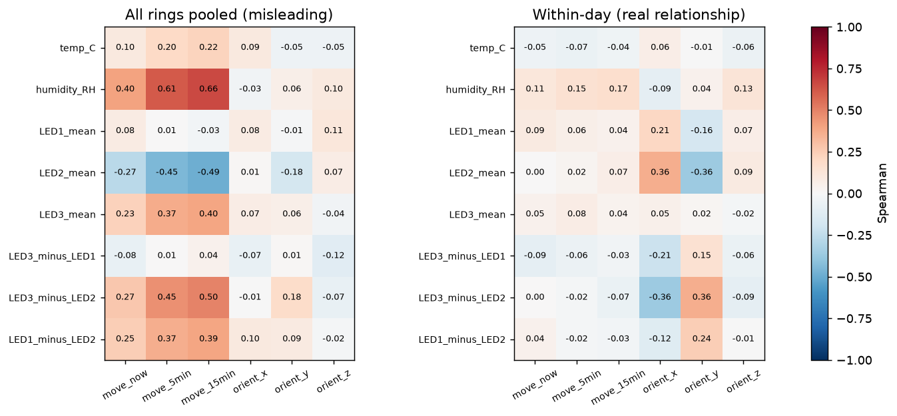

# Slow Features vs Motion

**Question:** do the slow features (temperature, humidity, LED levels, LED differences) change with the accelerometer (how much the hand moves and how it is held)?

## What's here

- `slow_features_vs_motion.ipynb` - the notebook. Set `DATA_DIR` to the cohort folder and Run All. It works on the raw `*_labeled_continuous*.xlsx` files, so no feature extraction is needed.
- `plots/` - one time series plot per day (temperature, humidity, LED differences, movement, label) and `correlation_heatmaps.png`
- `results/` - the tables behind the findings

## Findings

- **Data:** 3 rings (PID101, 102, 104), days 0 to 10. That's 29 days and about 13.7k windows.
- **What we checked:** how temperature, humidity, LED levels and LED differences relate to the accelerometer (how much the hand moves and how it's held).
- **Movement:** barely affects the slow features within a day (correlation about 0.1). The strong links you see when all rings are mixed come from differences between rings, not from movement.
- **Hand orientation:** the one real link. It affects LED2 and LED3-LED2 (about ±0.36 within a day), probably because tilting the hand shifts how the ring sits on the finger.
- **Biggest drivers:** day explains 29 to 57% of the variation and ring explains up to 40%. The accelerometer explains only 15 to 23%.
- **Stress label:** explains under 3% of any slow feature within a day. On their own, these features are weak stress signals.
- **Data quality:** PID101's humidity is stuck at 99 to 100% (in 79% of its windows), so it's unreliable for that ring.
- **Temperature:** warms up over the first 10 to 20 minutes of a session, then slowly cools. We should skip or correct that warm-up period.

## Next steps

- Normalize per day and per ring before modeling
- Correct LED2 for orientation
- Drop or fix humidity for PID101

*Left: all rings mixed (misleading). Right: inside each day (the real relationship).*
